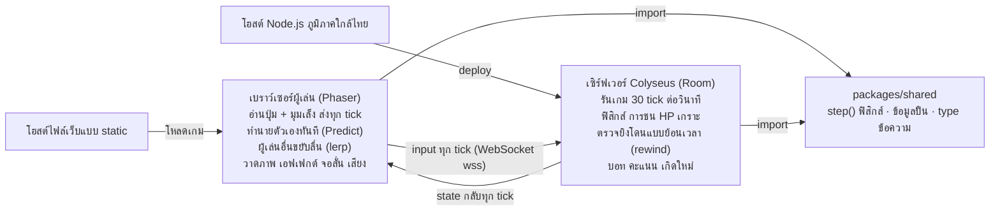

# แผนพัฒนาเกมแนว Armor Mayhem (Claude + Gemini)

อัปเดต: 25 พ.ย. 2026 · ต้นฉบับแก้ไขได้ที่ https://claude.ai/artifact/PuViikcCQJnobADU89HBeF

## ภาพรวมและขอบเขต

เป้าหมายคือเกมยิง 2D แบบ side-scrolling แนว Armor Mayhem ที่เล่นบนเบราว์เซอร์และเล่นออนไลน์กับเพื่อนได้ โดยต่อระบบออนไลน์ตั้งแต่เฟส 2 แล้วค่อยเพิ่มบอทในเฟส 4 ([Armor Mayhem](https://nextquest.dev/games/armor-mayhem) ต้นฉบับเป็นเกม Flash ที่เล่นกับ AI)

**ต้องมีในเวอร์ชันแรก (MVP)**

- เดิน กระโดด และชนพื้นกับกำแพงได้
- เล็งด้วยเมาส์และยิงได้ มีปืน 3 แบบ: ปืนพก ไรเฟิล ลูกซอง กด 1/2/3 สลับปืนได้ตลอด (ไม่มีระบบเก็บของในแมพ)
- มี HP กับเกราะ เกิดมาพร้อมเกราะเต็ม ตายแล้วเกิดใหม่ได้ และอมตะสั้นๆ หลังเกิด
- มีบอท 3–5 ตัว
- แมพ 1 แมพ โหมด deathmatch แบบจับเวลา
- ห้องออนไลน์ 2–4 คน เข้าห้องด้วยรหัสห้อง

**ตัดออกจากเวอร์ชันแรก ไว้ทำทีหลัง**

- แคมเปญ ร้านค้า และระบบเงิน
- โหมด CTF และ territory control
- Slow-mo: ในโหมดออนไลน์ทำยาก เพราะเวลาของทุกคนต้องเดินเท่ากัน ให้เปลี่ยนเป็นบัฟความเร็วหรือบัฟกันดาเมจแทน
- บัญชีผู้ใช้ ล็อกอิน และตารางอันดับ
- Matchmaking อัตโนมัติ

ห้ามใช้ชื่อ ภาพ หรือเสียงจากเกมต้นฉบับ ต้องใช้ asset ของตัวเองหรือ asset ฟรีที่อนุญาตให้ใช้

## Tech stack และโครงสร้างโปรเจกต์

ใช้ TypeScript ทั้งฝั่งเกมและเซิร์ฟเวอร์ จะได้แชร์โค้ดกันได้และตรงกับสาย web dev จุดที่สำคัญที่สุดคือเขียนฟิสิกส์เองแบบง่ายๆ ไว้ใน `shared` แทน Arcade Physics ของ Phaser เพราะเซิร์ฟเวอร์กับเกมต้องคำนวณการเคลื่อนที่ด้วยโค้ดชุดเดียวกัน

| ส่วน | ใช้ | ทำไม |
| --- | --- | --- |
| ตัวเกม (client) | Phaser + TypeScript + Vite | วาดภาพ เสียง และรับปุ่มบนเบราว์เซอร์ |
| เซิร์ฟเวอร์เกม | [Colyseus](https://docs.colyseus.io/) (Node.js) | มีระบบห้อง ซิงก์ state และ netcode ในตัวตั้งแต่ 0.18 มี [บทสอนคู่กับ Phaser](https://docs.colyseus.io/tutorial/phaser/basic-player-movement) |
| โค้ดกลาง (shared) | แพ็กเกจ TypeScript | ฟิสิกส์ ข้อมูลปืน และ type ของข้อความ ใช้ได้ทั้ง 2 ฝั่ง |
| แมพ | Tiled → ไฟล์ JSON ใน `shared/maps` | เกมใช้วาดภาพ เซิร์ฟเวอร์ใช้เช็กการชน จากไฟล์เดียวกัน |
| จัดการโปรเจกต์ | pnpm workspaces + Git/GitHub | รวม 3 แพ็กเกจไว้ใน repo เดียว |
| Asset | [Kenney](https://kenney.nl/assets) และ [itch.io](https://itch.io/game-assets/free) | ภาพและเสียงฟรี เช็ก license ทุกชิ้น |

```text
armor-game/
├─ CLAUDE.md               # ชี้ไปที่ docs/rules.md
├─ GEMINI.md               # ชี้ไปที่ docs/rules.md
├─ docs/
│  ├─ rules.md             # กฎกลางที่ AI ทุกตัวต้องทำตาม
│  └─ plan.md              # แผนนี้ + สถานะล่าสุด
└─ packages/
   ├─ shared/
   │  ├─ src/              # step.ts (ฟิสิกส์ + การชน), map.ts, weapons.ts, messages.ts
   │  └─ maps/             # แมพจาก Tiled (JSON) ใช้ทั้ง client และ server
   ├─ client/
   │  ├─ src/              # Phaser scenes, input, เอฟเฟกต์
   │  └─ public/           # ภาพ tileset, sprites, เสียง
   └─ server/              # Colyseus rooms, บอท, ตรวจการยิงโดน
```

## ระบบออนไลน์

เซิร์ฟเวอร์ตัดสินทุกอย่าง และทั้งสองฝั่งใช้โค้ด `shared` ชุดเดียวกัน



ผู้เล่นส่งแค่ปุ่มที่กดกับมุมเล็งไปที่เซิร์ฟเวอร์ เซิร์ฟเวอร์คำนวณผลด้วยโค้ด `shared` แล้วส่ง state กลับ ส่วนเบราว์เซอร์รันโค้ดชุดเดียวกันเพื่อทำนายตัวเองล่วงหน้า

**ลำดับงานใน 1 tick**

1. client อ่านปุ่มกับมุมเล็ง แล้วส่ง input 1 ชุดต่อ tick
2. client รัน `step()` กับตัวเองทันที ผู้เล่นจะไม่รู้สึกว่าดีเลย์
3. เซิร์ฟเวอร์รัน `step()` เดียวกันกับ input ของทุกคน ตรวจยิงโดนโดยย้อนเป้าไปตำแหน่งที่คนยิงเห็น แล้วส่ง state กลับ
4. client เทียบกับ state จริง ถ้าไม่ตรงจะแก้ตำแหน่ง แล้วรัน input ที่เซิร์ฟเวอร์ยังไม่ยืนยันซ้ำ
5. ผู้เล่นคนอื่นและบอทจะแสดงย้อนหลังเล็กน้อย เพื่อให้ขยับลื่น

**การ deploy ขึ้นเว็บ**

- ตัวเกม: `vite build` จะได้ไฟล์ static แล้วอัปขึ้นโฮสต์ไฟล์เว็บ
- เซิร์ฟเวอร์: รัน Node.js บนโฮสต์ที่รองรับ WebSocket ต้องเป็น `wss://` ที่มี HTTPS เพราะหน้าเว็บ HTTPS เชื่อม `ws://` ธรรมดาไม่ได้
- ช่วงพัฒนาให้รันบนเครื่องตัวเอง เฟส 2 ให้เพื่อนเข้าผ่าน tunnel (เช่น Cloudflare Tunnel ซึ่งได้ `wss://` มาเลย) แล้วค่อยเช่าโฮสต์จริงในเฟส 4 หรือใช้ Colyseus Cloud ซึ่งเป็นบริการเสียเงิน
- ตอน deploy จริงต้อง bundle เซิร์ฟเวอร์เป็น JavaScript ก่อน เพราะ Node ไม่ยอมรันไฟล์ `.ts` ที่อยู่ใต้ `node_modules` และต้องตั้ง `VITE_SERVER_URL` ให้ตัวเกมรู้ที่อยู่เซิร์ฟเวอร์ พร้อมตั้ง CORS
- เข้าห้องด้วยรหัส: ตั้ง `roomId` เองเป็นตัวพิมพ์ใหญ่ 4–5 ตัวตอนสร้างห้อง และแชร์เป็นลิงก์ `?room=XXXX` ได้ หน้า lobby ทำด้วย HTML/CSS ทับบนเกม

## เทคนิคจากการค้นคว้า

เรื่องที่สำคัญที่สุดคือ [Colyseus 0.18 มี netcode สำเร็จรูป](https://docs.colyseus.io/netcode) (prediction, interpolation, lag compensation) เลยไม่ต้องเขียนเองตั้งแต่ศูนย์ งานหลักของเราคือเขียนฟังก์ชัน `step` ใน `shared` ที่รันบน client กับ server แล้วได้ผลเท่ากันทุกครั้ง

| เรื่อง | เทคนิค | ใช้ในเกมนี้ | แหล่ง |
| --- | --- | --- | --- |
| Fixed timestep | อัปเดตเกมเป็นจังหวะคงที่ ไม่ผูกกับ FPS ของเครื่อง | 30 tick/วินาที แต่คำนวณฟิสิกส์ 2 รอบย่อยต่อ tick ตั้งแต่แรก กันทะลุพื้น อ่าน dt จาก `ctx.dt` เสมอ และฝั่ง client วาดภาพแบบ lerp ระหว่าง tick ให้ลื่นบนจอ 60–144 Hz | [Fix Your Timestep!](https://gafferongames.com/post/fix_your_timestep/) |
| Client-side prediction | ตัวเราขยับทันทีที่กด แล้วแก้ตำแหน่งตามเซิร์ฟเวอร์ | `Predict` ของ Colyseus | [Gambetta](https://gabrielgambetta.com/client-side-prediction-server-reconciliation.html) |
| Entity interpolation | แสดงผู้เล่นคนอื่นย้อนหลังเล็กน้อยให้ขยับลื่น | โหมด `lerp` ของ Colyseus | [Gambetta](https://gabrielgambetta.com/entity-interpolation.html) |
| Lag compensation | เซิร์ฟเวอร์ย้อนเวลาไปตำแหน่งที่คนยิงเห็นตอนยิง | ปืนพก ไรเฟิล และลูกซอง (ยิงหลายเส้น) ใช้ `allowRewindState` + `rewind.lastSeenBy` | [Valve](https://developer.valvesoftware.com/wiki/Lag_Compensation) |
| กระสุนที่บินได้ | สร้างกระสุนฝั่ง client ก่อน แล้วส่งต่อให้เซิร์ฟเวอร์ | ระเบิดหรือจรวด (หลัง MVP) ใช้ `predict.spawns` | [Colyseus](https://docs.colyseus.io/netcode) |
| Determinism | ห้าม `Math.random()` และ `Date.now()` ใน `step` ทุกอย่างที่ step อ่านต้องมาจาก input | ใส่เป็นกฎใน rules.md และเขียน test รัน input ชุดเดิม 2 รอบต้องได้ผลเท่ากัน | [Colyseus](https://docs.colyseus.io/netcode/determinism) |
| บอทหาทาง | สร้างกราฟจากแพลตฟอร์ม มีลิงก์เดิน กระโดด ตก แล้วหาทางด้วย A* | ส่วนที่ยากคือให้บอทกดปุ่มตามเส้นทางได้แม่น เลยเริ่มจากบอทแบบง่ายก่อน: ออกแบบแมพให้มี jump pad ไว้ขึ้นชั้นบน บอทเดินหาเป้าในชั้นเดียวกัน ใช้ jump pad เมื่อเป้าอยู่สูงกว่า A* เต็มรูปแบบเป็นของเสริม | [gamedev.net](https://gamedev.net/tutorials/programming/artificial-intelligence/generalized-platformer-ai-pathfinding-r3924) |
| Game feel | จอสั่น กล้องถีบตอนยิง ตัวที่โดนกะพริบขาว ฝุ่นตอนลงพื้น เสียงชัด | ทำฝั่ง client เท่านั้น ใส่ใน `if (!ctx.isReplay)` ไม่งั้นเสียงจะดังซ้ำตอนแก้ตำแหน่ง | [Vlambeer](https://infovore.org/?p=5275) |

เกม offline มักหยุดเกมสั้นๆ ตอนยิงโดน แต่เกมออนไลน์หยุดทั้งเกมไม่ได้ ให้ค้างเฉพาะภาพตัวที่โดนแทน บทสอน [Colyseus + Phaser](https://docs.colyseus.io/tutorial/phaser) ให้อ่านเพื่อเข้าใจแนวคิดอย่างเดียว ไม่ต้องเขียนตาม เพราะใช้เวอร์ชันเก่าและใช้ `@type` decorator ที่โปรเจกต์นี้รันไม่ได้ ตอนเขียนจริงให้ขึ้นโครงจาก docs netcode ของ 0.18 โดยตรง

## แผน 5 เฟส

ต่อออนไลน์ตั้งแต่เฟส 2 และต้องผ่านด่านก่อนขึ้นเฟสใหม่ ถ้ายังไม่ผ่านให้แก้ในเฟสเดิมก่อน เพราะบั๊ก netcode ที่ค้างไว้จะหายากขึ้นเมื่อมีระบบอื่นมาทับ

| เฟส | เป้าหมาย | ด่าน: ผ่านเมื่อ |
| --- | --- | --- |
| 1 · ตัวละครขยับได้ | ฟิสิกส์ใน shared วิ่ง กระโดด เล็ง ยิง บนแมพ Tiled (เล่นคนเดียว) | กระโดดรู้สึกแม่นมือ · test ฟิสิกส์รันซ้ำได้ผลเท่ากัน |
| 2 · ออนไลน์ขั้นแรก | ห้อง Colyseus, 2 เบราว์เซอร์เห็นกันขยับ, Predict + lerp | เพื่อนต่อเข้ามาจากอีกเครื่องได้ · ใส่ดีเลย์จำลองแล้วตัวไม่เด้ง |
| 3 · ยิงกันออนไลน์ | ปืน 3 แบบ, ตรวจยิงโดนแบบ rewind, HP เกราะ ตาย เกิดใหม่ | ยิงโดนเป้าที่วิ่งอยู่แม้มีดีเลย์ · เสียงและเอฟเฟกต์ไม่เล่นซ้ำ |
| 4 · บอท + deathmatch | บอทแบบง่ายบนเซิร์ฟเวอร์ + jump pad, จับเวลา คะแนน รหัสห้อง | เล่นครบ 1 แมตช์ 4 คน + บอทไม่ค้าง · deploy ขึ้นเว็บจริงแล้ว |
| 5 · ขัดเกลา + ของเพิ่ม | game feel, เสียง, แมพที่ 2 แล้วค่อยร้านค้าหรือโหมดอื่น | ให้เพื่อนลองเล่นจริง · เก็บ feedback แล้วเลือกงานถัดไป |

**เฟส 1: ตัวละครขยับได้**

- [x] ตั้ง repo แบบ pnpm workspaces 3 แพ็กเกจ พร้อม `rules.md`, `CLAUDE.md`, `GEMINI.md`
- [x] แมพแรกแบบ Tiled ใน `shared/maps` โหลดเข้า Phaser และเซิร์ฟเวอร์อ่านตารางการชนได้
- [x] เขียน `step()` ใน `shared`: เดิน กระโดด ชน tile, 2 รอบย่อยต่อ tick, coyote time + jump buffer อยู่ใน state
- [x] input latch และมุมเล็งจากพิกัดโลก กล้องตามตัวละคร
- [x] เล็งตามเมาส์ แขนกับปืนหมุนตาม และยิงได้ (คูลดาวน์ใน `step()`, เช็กโดนด้วย `resolveShot()` ที่ raycast ชนกำแพง)
- [x] โหมด debug วาดกรอบชนของผู้เล่น tile และเส้นกระสุน
- [x] เขียน unit test ฟิสิกส์ด้วย Vitest
- [ ] ผ่านด่าน: ลองเล่นแล้วปรับค่าใน `PHYSICS` จนกระโดดรู้สึกแม่นมือ

**เฟส 2: ออนไลน์ขั้นแรก**

- [ ] อ่านบทสอน Colyseus + Phaser และบทความ Gambetta เพื่อเข้าใจแนวคิด (ไม่ต้องเขียนตาม)
- [ ] สร้าง GameRoom ใช้ `setFixedTimestep` และ `defineInput` ประกาศ Schema แบบฟังก์ชัน ไม่ใช้ decorator
- [ ] client ใช้ `room.input()` + `Predict` กับตัวเอง และ `lerp` กับคนอื่น
- [ ] โหมด debug วาดตำแหน่งจริงจากเซิร์ฟเวอร์ทับตำแหน่งที่ทำนาย
- [ ] ทดสอบ 2 แท็บพร้อมดีเลย์จำลอง และเช็กว่าสลับแท็บแล้วกลับมาไม่พัง
- [ ] เปิด tunnel ให้เพื่อนเข้าจากอีกเครือข่าย

**เฟส 3: ยิงกันออนไลน์**

- [ ] ข้อมูลปืน 3 แบบใน `shared/weapons.ts` (ลูกซองกระจายมุมคงที่)
- [ ] ตรวจยิงโดนบนเซิร์ฟเวอร์ด้วย `resolveShot()` กับตำแหน่งจาก `allowRewindState` + `rewind.lastSeenBy`
- [ ] HP เกราะ (คำนวณใน shared และมี test) ตาย เกิดใหม่
- [ ] เลือกจุดเกิดที่ไกลศัตรู และอมตะสั้นๆ หลังเกิด
- [ ] เอฟเฟกต์ยิงและโดนฝั่ง client ใน `if (!ctx.isReplay)`

**เฟส 4: บอท + deathmatch**

- [ ] jump pad ใน `step()` และวางในแมพ
- [ ] บอทแบบง่ายกับ state machine (ลาดตระเวน ไล่ ยิง หนี) ใช้ jump pad ขึ้นชั้นบน
- [ ] Deathmatch: จับเวลา คะแนน หน้าสรุปผล และกติกาคนเข้า/ออกกลางแมตช์
- [ ] หน้า lobby (HTML) สร้างห้อง ใส่รหัสห้องสั้น และลิงก์ `?room=`
- [ ] Deploy จริง: bundle เซิร์ฟเวอร์, `VITE_SERVER_URL`, CORS, `wss://`

**เฟส 5: ขัดเกลา + ของเพิ่ม**

- [ ] จอสั่น กล้องถีบ particle และเสียง
- [ ] แมพที่ 2
- [ ] ของเสริมถ้ามีเวลา: พื้นกดทะลุลงได้, บอทหาทางด้วย A*
- [ ] เก็บ feedback แล้วเลือกของเพิ่ม: ร้านค้า CTF หรือ territory

## แบ่งงาน Claude กับ Gemini

ในแต่ละฟีเจอร์ ให้ AI ตัวหนึ่งเป็นคนเขียน อีกตัวเป็นคนรีวิว อย่าให้สองตัวแก้ไฟล์เดียวกันพร้อมกัน เพราะสไตล์โค้ดจะตีกันและหาบั๊กยาก

| งาน | ใช้ตัวไหน | หมายเหตุ |
| --- | --- | --- |
| ออกแบบ netcode และฟิสิกส์ใน `shared` | Claude Opus 5.5 | ถ้าพลาดตรงนี้ต้องรื้อทั้งเกม |
| เขียนโค้ดฟีเจอร์รายวัน | Claude Sonnet 5.5 ใน Claude Code หรือ Gemini 4 Neon ใน Antigravity | เลือกตัวหลักตัวเดียวต่อเฟส |
| รีวิว diff ก่อน merge | ตัวที่ไม่ได้เขียนโค้ดนั้น | ได้มุมมองที่สอง จับบั๊กที่คนเขียนมองข้าม |
| แก้บั๊กยาก เช่น desync ตัวละครกระตุก | Claude Opus 5.5 หรือ Gemini 4 Carbon | ส่ง log กับไฟล์ที่เกี่ยวข้องไปด้วย |
| อ่านและสรุปโค้ดทั้ง repo | Gemini 4 Neon | context ยาว 1 ล้าน token |
| ถามเร็วๆ เช่น API ของ Phaser หรือ Colyseus | Gemini 4 Hydrogen หรือ Claude Haiku 5.5 | เร็วและประหยัด |

ตระกูล Gemini 4 มี 3 ระดับ: Carbon สำหรับงานยากที่สุด, Neon สมดุลสำหรับงานโค้ด และ Hydrogen สำหรับงานเร็ว ในแอป Gemini และ Antigravity นั้น Neon ใช้ได้เฉพาะสมาชิก Pro หรือ Ultra ([Google](https://blog.google/innovation-and-ai/models-and-research/gemini-models/introducing-gemini-4-neon/))

## ไฟล์กฎกลางและ prompt พร้อมใช้

เขียนกฎไว้ที่ `docs/rules.md` ไฟล์เดียว แล้วให้ `CLAUDE.md` กับ `GEMINI.md` ดึงไฟล์นี้มาใช้ AI ทั้งสองตัวจะได้ทำงานตามกฎชุดเดียวกัน Claude Code อ่าน `CLAUDE.md` ส่วน Gemini CLI อ่าน [`GEMINI.md`](https://geminicli.com/docs/cli/gemini-md/) เองอัตโนมัติ และทั้งสองไฟล์ import ไฟล์อื่นด้วย `@` ได้

ตัวไฟล์จริงอยู่ที่ `docs/rules.md` ใน repo นี้แล้ว (มีหัวข้อ "ข้อตกลงโค้ด" กับ "คำสั่ง" เพิ่มจากร่างแรก)

**CLAUDE.md** มีบรรทัดเดียวคือ `@docs/rules.md` ส่วน **GEMINI.md** มีบรรทัดเดียวคือ `@./docs/rules.md`

**Prompt 1: เริ่มฟีเจอร์ (ส่งให้ AI ตัวหลัก)**

```text
อ่าน docs/rules.md และ docs/plan.md ก่อน
งานนี้: [ชื่อฟีเจอร์] ของเฟส [เลข]
ต้องทำ: [...]  ไม่ต้องทำ: [...]
เสนอแผนสั้นๆ ว่าจะแก้ไฟล์ไหน รอผมตอบตกลงก่อนค่อยเขียนโค้ด
เสร็จแล้วบอกวิธีทดสอบด้วยมือ และอัปเดต "สถานะปัจจุบัน" ใน rules.md
```

**Prompt 2: รีวิวโค้ด (ส่งให้ AI อีกตัว)**

```text
นี่คือ git diff ของฟีเจอร์ [ชื่อ] ที่ AI อีกตัวเขียน [แปะ diff]
เช็กตาม docs/rules.md:
1. client ส่งค่าที่เซิร์ฟเวอร์ควรคำนวณเองหรือเปล่า
2. บั๊กที่เป็นไปได้
3. จุดที่ซับซ้อนเกินจำเป็น
ตอบเป็นรายการ เรียงจากร้ายแรงสุด ยังไม่ต้องแก้โค้ด
```

**Prompt 3: แก้บั๊กออนไลน์**

```text
อาการ: [เช่น ตัวละครเด้งกลับตอนกระโดด]
ทำให้เกิดได้โดย: [ขั้นตอน]
log: [แปะ]
ไฟล์ที่เกี่ยวข้อง: [รายชื่อไฟล์]
หาสาเหตุและอธิบายให้เข้าใจก่อน แล้วค่อยเสนอวิธีแก้
```

**Prompt 4: เรียนจากโค้ดที่ AI เขียน**

```text
อธิบายไฟล์ [ชื่อไฟล์] ทีละส่วนเป็นภาษาไทย สำหรับคนที่พื้นฐาน TypeScript ยังไม่แน่น
จากนั้นตั้งคำถาม 3 ข้อให้ผมตอบ เพื่อเช็กว่าเข้าใจจริง
```

## ทำงานร่วมกับ Gemini

Claude กับ Gemini คุยกันเองไม่ได้ คุณเป็นคนส่งงานต่อระหว่างสองตัว โดยใช้ไฟล์ใน repo (`rules.md`, `plan.md`) เป็นตัวกลาง ทั้งสองตัวจะได้เห็นข้อมูลชุดเดียวกัน

1. เซฟแผนนี้เป็น `docs/plan.md` ใน repo
2. ส่ง `plan.md` ให้ Gemini รีวิวด้วย Prompt 5
3. เอาคำตอบของ Gemini มาแปะให้ Claude ด้วย Prompt 6 แล้วให้ Claude แก้แผน
4. ตอนเขียนโค้ด ให้ตัวหนึ่งเขียน อีกตัวรีวิวด้วย Prompt 2 สลับบทกันได้ทุกเฟส

ข้อ 1–3 ทำแล้วเมื่อ 25 พ.ย. 2026: Gemini 4 Carbon (High) รีวิวผ่าน Antigravity CLI แล้วแผนนี้แก้ตามข้อที่ Claude เห็นด้วย ได้แก่ แมพอยู่ใน shared, sub-step ฟิสิกส์, แยกคูลดาวน์ออกจากการเช็กยิงโดน, raycast กำแพง, input latch, โหมด debug, schema แบบฟังก์ชัน, บอทแบบง่าย + jump pad, ลูกซองมุมคงที่, รหัสห้องสั้น, tunnel ในเฟส 2, ขั้นตอน deploy เซิร์ฟเวอร์ และอมตะหลังเกิด

**Prompt 5: ให้ Gemini รีวิวแผน**

```text
คุณเป็น senior game developer ที่เคยทำเกมออนไลน์บนเว็บ
อ่านแผนนี้ [แนบ plan.md] แล้วช่วยหา:
1. จุดที่เสี่ยงทำไม่เสร็จ หรือยากเกินไปสำหรับนักศึกษาที่พื้นฐานโค้ดยังไม่แน่น
2. เทคนิคหรือเครื่องมือที่ดีกว่าที่แผนเลือก พร้อมเหตุผล
3. ขั้นตอนที่ขาดไป
ตอบเป็นข้อ แต่ละข้อบอกความสำคัญ (มาก/ปานกลาง/น้อย) ยังไม่ต้องเขียนโค้ด
```

**Prompt 6: ส่งผลรีวิวกลับให้ Claude**

```text
นี่คือความเห็นของ Gemini ต่อแผน [แปะ]
บอกว่าข้อไหนเห็นด้วย ข้อไหนไม่เห็นด้วย พร้อมเหตุผล
แล้วแก้แผนเฉพาะข้อที่เห็นด้วย
```

## กฎการทำงานและความเสี่ยง

ความเสี่ยงใหญ่ที่สุดคือระบบออนไลน์ เลยต้องทำตั้งแต่เฟส 2 และทดสอบบ่อยๆ ไม่เก็บไว้ทำตอนท้าย

**กฎการทำงานกับ AI**

1. หนึ่งฟีเจอร์ = หนึ่ง branch = หนึ่งคำสั่ง และ commit ทุกครั้งที่เล่นได้
2. อ่านทุกไฟล์ที่ AI แก้ก่อน commit ถ้าอธิบายไม่ได้ให้ใช้ Prompt 4
3. เขียน unit test (Vitest) ให้ฟิสิกส์ใน `shared` เพราะ client กับเซิร์ฟเวอร์ต้องคำนวณได้ผลเท่ากัน
4. ทดสอบออนไลน์ด้วย 2 แท็บเบราว์เซอร์ และใส่ดีเลย์จำลองในเซิร์ฟเวอร์ช่วงทดสอบ จะได้เห็นอาการแลคจริง
5. จบฟีเจอร์แล้วอัปเดต "สถานะปัจจุบัน" ใน `rules.md` ทุกครั้ง AI ตัวถัดไปจะรู้ว่าถึงไหนแล้ว

| ความเสี่ยง | วิธีป้องกัน |
| --- | --- |
| ระบบออนไลน์ยากกว่าที่คิด | เริ่มตั้งแต่เฟส 2 ใช้ห้องเล็ก 2–4 คน และทำตามบทสอน Colyseus + Phaser |
| ฟิสิกส์สองฝั่งไม่ตรงกัน ตัวละครเด้งกลับ | ใช้โค้ดชุดเดียวใน `shared`, fixed timestep และ unit test |
| ผู้เล่นโกง | เซิร์ฟเวอร์ตัดสินตำแหน่ง HP และการยิงโดนเอง |
| ผู้เล่นในไทยแลค | เลือกเซิร์ฟเวอร์ในภูมิภาคใกล้ๆ เช่น สิงคโปร์ |
| ค่าเซิร์ฟเวอร์ | ช่วงพัฒนารันบนเครื่องตัวเอง ค่อยเช่าโฮสต์ตอนจะให้คนอื่นเล่น |
| ได้โค้ดที่ตัวเองไม่เข้าใจ | อ่าน diff ทุกครั้ง และใช้ Prompt 4 |
| AI สองตัวเขียนสไตล์ต่างกัน | ใช้ `rules.md` ไฟล์เดียว และแบ่งบทคนเขียน/คนรีวิว |
| AI เขียน API รุ่นเก่า (Phaser 3, Colyseus 0.16) ปนเข้ามา | กฎใน `rules.md` ให้เช็ก type ของเวอร์ชันที่ติดตั้งจริงก่อนใช้ |
| ขอบเขตบาน | ยึดรายการ MVP ฟีเจอร์ใหม่ให้จดไว้ทำหลังเฟส 5 |

## แหล่งข้อมูล

- [Armor Mayhem — NextQuest](https://nextquest.dev/games/armor-mayhem)
- [Armor Mayhem review — Felix](https://felixonline.co.uk/articles/2013-10-30-amore-not-part-of-armor-mayham/)
- [Colyseus docs](https://docs.colyseus.io/)
- [Colyseus netcode (0.18+)](https://docs.colyseus.io/netcode)
- [Colyseus: Determinism & The Contract](https://docs.colyseus.io/netcode/determinism)
- [Colyseus + Phaser tutorial](https://docs.colyseus.io/tutorial/phaser/basic-player-movement)
- [Phaser + Colyseus: Grapplenauts](https://www.phaser.io/news/2026/03/grapplenauts-phaser-multiplayer-browser-game)
- [Gabriel Gambetta: Client-Side Prediction and Server Reconciliation](https://gabrielgambetta.com/client-side-prediction-server-reconciliation.html)
- [Gabriel Gambetta: Entity Interpolation](https://gabrielgambetta.com/entity-interpolation.html)
- [Valve: Lag Compensation](https://developer.valvesoftware.com/wiki/Lag_Compensation)
- [Glenn Fiedler: Fix Your Timestep!](https://gafferongames.com/post/fix_your_timestep/)
- [Generalized Platformer AI Pathfinding — GameDev.net](https://gamedev.net/tutorials/programming/artificial-intelligence/generalized-platformer-ai-pathfinding-r3924)
- [Making Game “Feel” (Vlambeer interview notes)](https://infovore.org/?p=5275)
- [Introducing Gemini 4 Neon — Google](https://blog.google/innovation-and-ai/models-and-research/gemini-models/introducing-gemini-4-neon/)
- [GEMINI.md — Gemini CLI docs](https://geminicli.com/docs/cli/gemini-md/)
